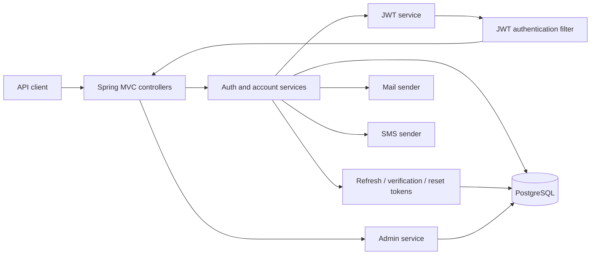
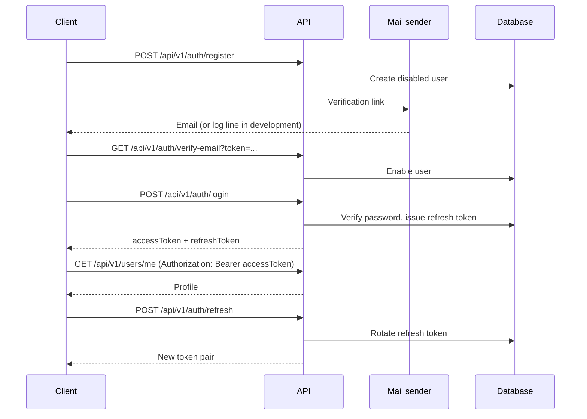

# JWT Security Starter

A Spring Boot starter you can copy when you need stateless JWT authentication, role-based access, and a complete account lifecycle. It is meant to be easy for beginners to read, and strict enough to use as a foundation for a real API.

The original version of this project was co-developed with [Milad Tehrany](https://github.com/MiladTehrany). This repository modernizes that work: the earlier commit history is preserved, with credentials and third-party brand assets removed from it. The current tree uses a PostgreSQL schema, thorough tests, and environment-based configuration.

## Features

- Stateless JWT access tokens and opaque refresh tokens with rotation and reuse detection
- Password hashing with BCrypt (strength 12)
- Role- and permission-based authorization, including method security
- Registration with a single-use, expiring email verification token
- Password reset with a single-use, expiring token and an optional SMS notification hook
- Account lockout after failed sign-in attempts, plus in-memory rate limiting on auth endpoints
- Configurable CORS (no wildcard-by-default)
- Bean Validation on every request body
- RFC 7807 problem-details error responses
- OpenAPI 3 documentation and Swagger UI
- Flyway migrations on PostgreSQL
- Pluggable mail and SMS senders (logging implementations by default; SMTP optional)
- Secrets loaded from environment variables
- Docker Compose with PostgreSQL and [Mailpit](https://mailpit.axllent.org/)
- Multi-stage Dockerfile that builds the application from source

## Requirements

- Java 17 or later (Java 21 is recommended)
- Maven 3.9+ (a wrapper is included)
- PostgreSQL 16 for local or production use (tests use Testcontainers when Docker is available, otherwise H2)

This project targets **Spring Boot 4.1.3** and Spring Security 7. The Spring Boot 3.x line reached end of life in June 2026.

## Architecture



### Authentication flow



Refresh tokens are stored as SHA-256 hashes. When a token is rotated, the previous one is revoked. If a revoked token is presented again, the entire token family is revoked. Changing or resetting a password also revokes every refresh token for that user.

## Quick start

1. Copy the environment template and generate a signing secret:

   ```bash
   cp .env.example .env
   echo "APP_JWT_SECRET=$(openssl rand -base64 48)" >> .env
   ```

   The JWT secret must decode to at least 32 bytes. The application will refuse to start if it is missing or too short.

2. Start PostgreSQL and Mailpit, then run the API:

   ```bash
   docker compose up -d postgres mailpit
   set -a && source .env && set +a
   ./mvnw spring-boot:run
   ```

   Or build and start everything with Compose, after `APP_JWT_SECRET` is set in `.env`:

   ```bash
   docker compose up --build
   ```

3. Optional: set `APP_ADMIN_EMAIL`, `APP_ADMIN_USERNAME`, and `APP_ADMIN_PASSWORD` to create a bootstrap administrator on first startup.

4. Open [http://localhost:8080/swagger-ui.html](http://localhost:8080/swagger-ui.html) and [http://localhost:8025](http://localhost:8025) (Mailpit) if you set `APP_MAIL_MODE=smtp`.

With the default `APP_MAIL_MODE=logging`, verification and reset links are written to the application log instead of being sent over SMTP.

## Endpoint reference

All endpoints are under `/api/v1`. Error responses use `application/problem+json`.

| Method | Path | Access | Description |
|--------|------|--------|-------------|
| `POST` | `/auth/register` | Public | Create a disabled account and send a verification email |
| `GET` | `/auth/verify-email?token=` | Public | Enable the account |
| `POST` | `/auth/resend-verification` | Public | Resend the verification email (generic response) |
| `POST` | `/auth/login` | Public | Sign in with username or email |
| `POST` | `/auth/refresh` | Public | Rotate a refresh token |
| `POST` | `/auth/logout` | Public (refresh token in body) | Revoke one refresh token |
| `POST` | `/auth/logout-all` | Authenticated | Revoke every refresh token for the current user |
| `POST` | `/auth/forgot-password` | Public | Request a reset email (generic response) |
| `POST` | `/auth/reset-password` | Public | Set a new password with a one-time token |
| `GET` | `/users/me` | Authenticated | Current profile |
| `POST` | `/users/me/password` | Authenticated | Change password and revoke sessions |
| `GET` | `/admin/users` | `ROLE_ADMIN` + `admin:read` | Paginated user list |
| `GET` | `/admin/users/{id}` | `ROLE_ADMIN` + `admin:read` | User details |
| `PATCH` | `/admin/users/{id}` | `ROLE_ADMIN` + `admin:write` | Update enabled flag, lock state, or roles |
| `POST` | `/admin/users/{id}/unlock` | `ROLE_ADMIN` + `admin:write` | Clear a lockout |
| `GET` | `/demo/authenticated` | Authenticated | Method-security example |
| `GET` | `/demo/user` | `ROLE_USER` | Method-security example |
| `GET` | `/demo/moderator` | `ROLE_MODERATOR` or `ROLE_ADMIN` | Method-security example |
| `GET` | `/demo/admin` | `ROLE_ADMIN` | Method-security example |
| `GET` | `/demo/admin-write` | `admin:write` | Permission example |

### Register

```bash
curl -s -X POST http://localhost:8080/api/v1/auth/register \
  -H 'Content-Type: application/json' \
  -d '{
    "firstName": "Ada",
    "lastName": "Lovelace",
    "username": "ada",
    "email": "ada@example.com",
    "password": "ValidPass1",
    "phoneNumber": "+15551234567"
  }'
```

Passwords must be 8-72 characters and contain at least one letter and one digit. `phoneNumber` is optional.

### Login and call a protected endpoint

```bash
curl -s -X POST http://localhost:8080/api/v1/auth/login \
  -H 'Content-Type: application/json' \
  -d '{"username":"ada","password":"ValidPass1"}'

curl -s http://localhost:8080/api/v1/users/me \
  -H "Authorization: Bearer $ACCESS_TOKEN"
```

A successful login returns:

```json
{
  "accessToken": "<jwt>",
  "refreshToken": "<opaque token>",
  "tokenType": "Bearer",
  "expiresIn": 900
}
```

## Roles and permissions

Flyway seeds three roles:

| Role | Permissions |
|------|-------------|
| `ROLE_USER` | `user:read`, `user:write` |
| `ROLE_MODERATOR` | `user:read`, `user:write`, `admin:read` |
| `ROLE_ADMIN` | `user:read`, `user:write`, `admin:read`, `admin:write` |

New registrations receive `ROLE_USER` only. A bootstrap admin (if configured) receives `ROLE_ADMIN` and `ROLE_USER`.

Use `@PreAuthorize("hasRole('ADMIN')")` or `@PreAuthorize("hasAuthority('admin:write')")` on your own controllers. The `/api/v1/demo/**` endpoints show both styles.

## Configuration

All secrets come from the environment. See `.env.example` for the full list.

| Variable | Purpose | Default |
|----------|---------|---------|
| `APP_JWT_SECRET` | Base64 (or raw) signing key, at least 32 bytes | none (required) |
| `APP_JWT_ISSUER` | JWT issuer claim | `jwt-security-starter` |
| `APP_JWT_ACCESS_TTL` | Access token lifetime | `15m` |
| `APP_JWT_REFRESH_TTL` | Refresh token lifetime | `14d` |
| `APP_CORS_ALLOWED_ORIGINS` | Comma-separated origins | `http://localhost:3000,http://localhost:8080` |
| `APP_MAX_FAILED_LOGINS` | Failures before lockout | `5` |
| `APP_LOCKOUT_DURATION` | How long a lockout lasts | `15m` |
| `APP_LOGIN_RATE_LIMIT` | Auth requests per client IP in the window | `20` |
| `APP_MAIL_MODE` | `logging` or `smtp` | `logging` |
| `APP_MAIL_FROM` | From address used by the SMTP sender | `noreply@localhost` |
| `APP_BASE_URL` | Prefix for links in emails | `http://localhost:8080` |
| `APP_ADMIN_EMAIL` / `APP_ADMIN_USERNAME` / `APP_ADMIN_PASSWORD` | Optional bootstrap admin | empty |

Do not commit a real `.env` file. The defaults in `docker-compose.yml` for PostgreSQL are for local development only.

## How to extend

- **Mail provider.** Keep `APP_MAIL_MODE=smtp` and point Spring Mail at your server, or replace `NotificationMailSender` with your own bean (for example SendGrid or SES).
- **SMS provider.** `SmsSender` defaults to a logging implementation. Provide another `@Primary` `SmsSender` bean to call a real gateway. The default password-reset SMS does not include the reset token.
- **New roles.** Add rows in a new Flyway migration and assign them through `PATCH /api/v1/admin/users/{id}`.
- **Your own APIs.** Put controllers next to the existing ones and lock them down with `@PreAuthorize`. Leave `/api/v1/auth/**` public only for the documented anonymous operations.

## Security notes

- Access tokens are short-lived JWTs. Treat refresh tokens like passwords and send them only over HTTPS.
- Email and username conflicts return HTTP 409, which is easier to learn from, but it can be used for account enumeration. Tighten this in production if that matters to you.
- Forgot-password and resend-verification responses are generic so they do not reveal whether an email is registered.
- Login lockout is recorded in a separate transaction so failed attempts are not rolled back with the error response.
- Rate limiting is in-memory. Use a shared store such as Redis before you run more than one application instance.
- Swagger UI is public in this starter so beginners can explore the API. Restrict or disable it in production.
- CORS must be an explicit origin list. Do not use `*` together with `allow-credentials`.

## Testing

```bash
./mvnw verify
```

The suite includes unit tests for JWT handling, password rules, and rate limiting, plus MockMvc integration tests for registration, sign-in, lockout, refresh-token reuse, password reset, CORS, problem details, and every demo or admin authorization rule.

When Docker is available the tests start PostgreSQL with Testcontainers. Otherwise they fall back to an in-memory H2 database in PostgreSQL compatibility mode. GitHub Actions runs the same `./mvnw verify` command on Java 17 and 21.

## License

This project is licensed under the [Apache License 2.0](LICENSE).

## Credits

The original version of this project was co-developed with [Milad Tehrany](https://github.com/MiladTehrany).
